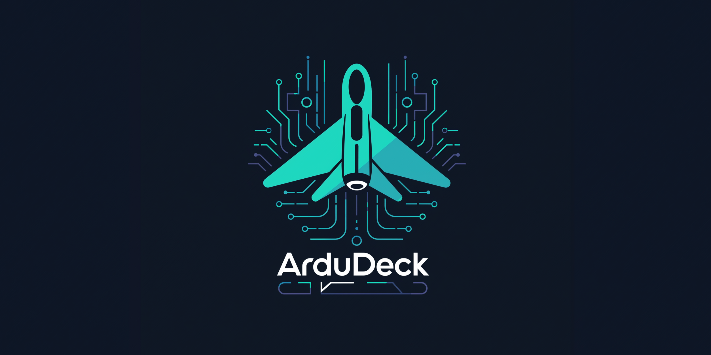
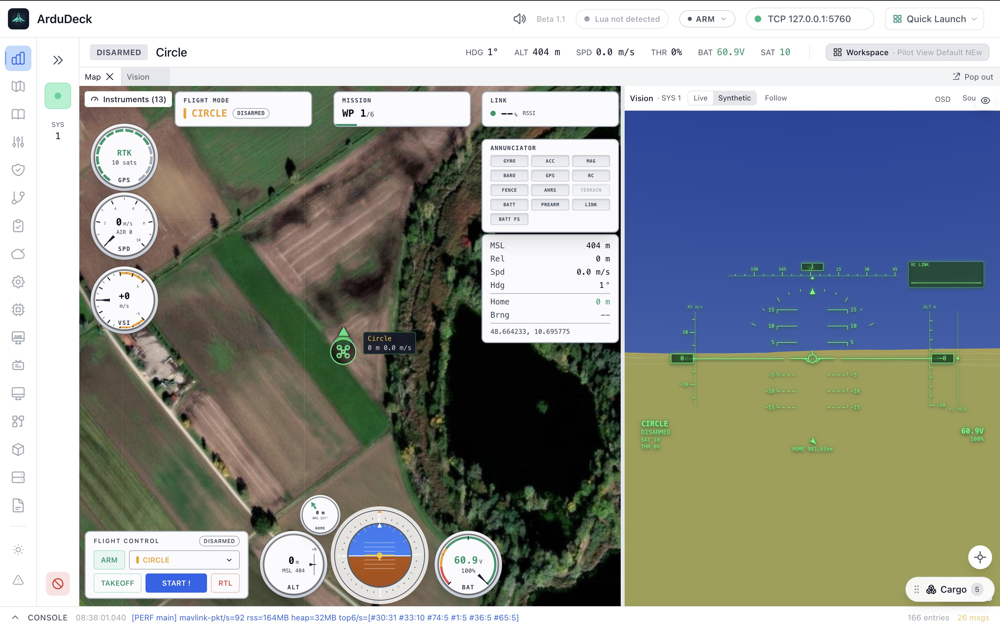
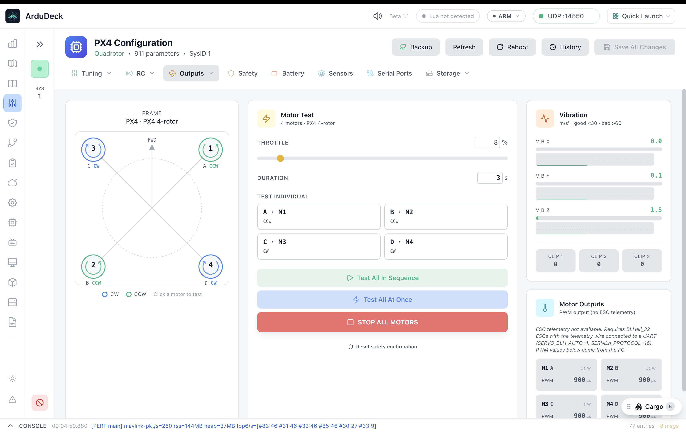
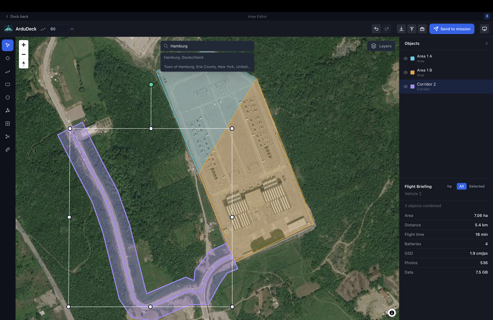
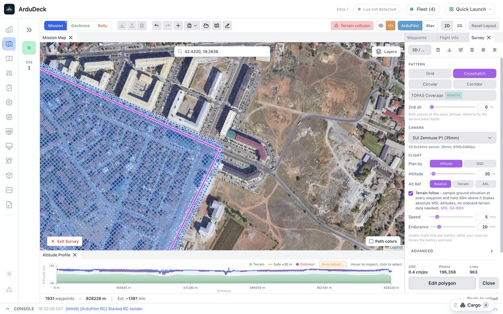
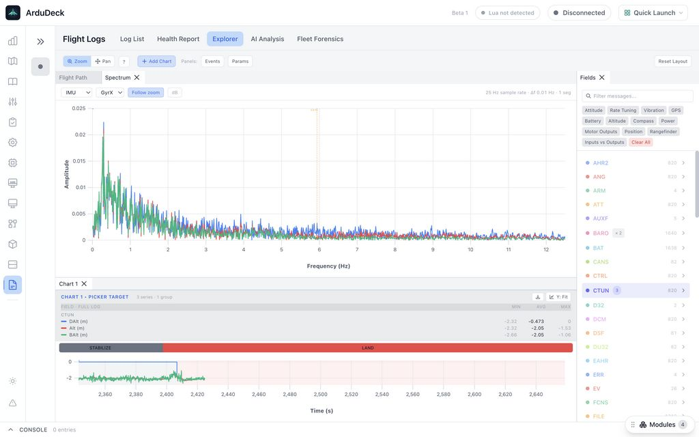
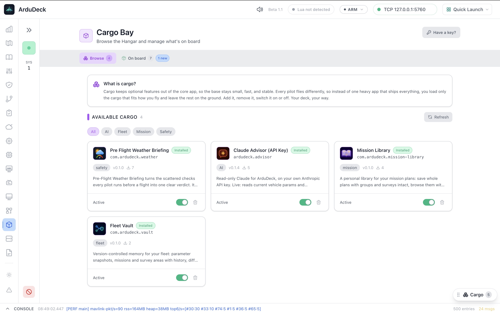

<p align="center">
  
</p>

<p align="center">
  <a href="https://opensource.org/licenses/GPL-3.0"></a>
  <a href="https://www.typescriptlang.org/"></a>
  <a href="https://www.electronjs.org/"></a>
  <a href="https://reactjs.org/"></a>
  <a href="https://mavlink.io/"></a>
  <a href="https://github.com/iNavFlight/inav/wiki/MSP-V2"></a>
  <a href="https://codecov.io/gh/rubenCodeforges/ardudeck"></a>
  <a href="https://discord.gg/JX2JdVXPPC"></a>
  <a href="https://forum.ardudeck.com"></a>
  <a href="https://ardudeck.com"></a>
</p>

<p align="center">
  <a href="https://ardudeck.com">Website</a> &nbsp;·&nbsp;
  <a href="https://ardudeck.com/docs/">Documentation</a> &nbsp;·&nbsp;
  <a href="https://ardudeck.com/blog/">Guides &amp; Screenshots</a> &nbsp;·&nbsp;
  <a href="https://forum.ardudeck.com">Community Forum</a> &nbsp;·&nbsp;
  <a href="https://discord.gg/JX2JdVXPPC">Discord</a>
</p>

<p align="center">
  <strong>A free, open-source ground control station for ArduPilot, PX4, Betaflight, and iNav. Windows, macOS and Linux.</strong>
</p>

<p align="center">
  <sub>Supported by</sub><br />
  <a href="https://adlerblix.de" target="_blank" rel="noopener noreferrer"></a>
  &nbsp;&nbsp;
  <a href="https://www.uav-dev.com" target="_blank" rel="noopener noreferrer"></a>
</p>

ArduDeck is an open-source ground control station built with Electron, React, and TypeScript. One app covers the whole workflow: connect, configure, calibrate, plan, fly, and analyze, for vehicles running ArduPilot or PX4 (MAVLink) or Betaflight/iNav (MSP), from a single quad on USB to a fleet of vehicles on radio, IP, or cellular links.

> **Beta** - ArduDeck is in beta. It is used in real flight operations, but expect rough edges and keep a backup configuration tool available. Ask questions and share setups on the [community forum](https://forum.ardudeck.com) or [Discord](https://discord.gg/JX2JdVXPPC), read the [documentation](https://ardudeck.com/docs/), or use the built-in [bug reporting](#bug-reporting) to help improve the project.

---

## Start here

- [How to download and set up ArduPilot](https://ardudeck.com/blog/ardupilot-download-setup-guide/) - firmware, ground station, flashing and connecting
- [First-time setup checklist](https://ardudeck.com/blog/ardupilot-first-setup-checklist/) - calibration, radio, flight modes and failsafes in order
- [Failsafe setup](https://ardudeck.com/blog/ardupilot-failsafe-setup/) and [AutoTune](https://ardudeck.com/blog/ardupilot-autotune-guide/)
- [Moving from Betaflight or INAV to ArduPilot](https://ardudeck.com/blog/betaflight-inav-to-ardupilot/)
- [Connect an AI agent to ArduDeck with MCP](https://ardudeck.com/blog/ardudeck-mcp-ai-agents/)

The guides are available in English, German, Spanish, French, Turkish, Ukrainian and Simplified Chinese.

---

## Table of Contents

- [Screenshots](#screenshots)
- [Features](#features)
- [Download & Install](#download--install)
- [Supported Vehicles & Firmware](#supported-vehicles--firmware)
- [Building from Source](#building-from-source)
- [Bug Reporting](#bug-reporting)
- [Languages & Translating](#languages--translating)
- [Contributing](#contributing)
- [Sponsors](#sponsors)
- [License](#license)
- [Acknowledgments](#acknowledgments)

---

## Screenshots

<p align="center">
  <a href="docs/screenshots/readme/map-cockpit.jpg?raw=true">
    
  </a>
  <br/>
  <em>The map is the cockpit: instruments docked on it, with a live or synthetic vision panel beside it</em>
</p>

<p align="center">
  <a href="docs/screenshots/readme/px4-support.jpg?raw=true">
    
  </a>
  <br/>
  <em>PX4 configuration: outputs, frame diagram, motor test and vibration readout</em>
</p>

<p align="center">
  <a href="docs/screenshots/readme/area-editor-overview.png?raw=true">
    
  </a>
  <br/>
  <em>Area Editor: survey areas and corridors over satellite imagery, with a live flight briefing</em>
</p>

<p align="center">
  <a href="docs/screenshots/readme/survey-coverage-plan.jpg?raw=true">
    
  </a>
  <br/>
  <em>Survey planning: coverage tracks, turn room and a smoothed flight path</em>
</p>

<p align="center">
  <a href="docs/screenshots/readme/log-explorer-fft.jpg?raw=true">
    
  </a>
  <br/>
  <em>Log Explorer: charts, per-series stats, flight modes and an FFT spectrum</em>
</p>

<p align="center">
  <a href="docs/screenshots/readme/hangar-cargo.jpg?raw=true">
    
  </a>
  <br/>
  <em>The Hangar: add hardware support, instruments and screens as cargo</em>
</p>

More screenshots and full documentation live on the website: [ardudeck.com/docs](https://ardudeck.com/docs/). Have a question or want to share a build? Join the [community forum](https://forum.ardudeck.com).

---

## Features

### Flight Operations
- **Dockable telemetry dashboard** - attitude, altitude, speed, GPS, battery, flight mode, and messages in IDE-style panels with saveable layouts
- **Interactive map** - live vehicle tracking, flight trail, multiple base layers, offline map downloads
- **Map overlays** - weather radar, animated wind flow, airspace zones, OpenAIP aviation charts, terrain elevation, and live air traffic (ADS-B / OGN)
- **Instruments on the map** - 30+ floating instruments (attitude, altitude and speed tapes, heading, battery, GPS and RTK, wind, rangefinder and proximity, EKF health, flight timer, mission progress, messages, and more), each with analog, numeric and compact variants; drag them anywhere and group them; they stay where you put them
- **Synthetic vision** - 3D terrain view with satellite imagery from your choice of map provider
- **Video and camera** - camera panel with pluggable sources (WebRTC, RTSP/ffmpeg, UVC), gimbal control, and a guided setup for wfb-ng / RunCam WiFiLink links
- **Stream out** - publish the synthetic vision or 3D sim view as RTSP, SRT or WebRTC for OpenCV, VLC or a browser
- **Flight commands** where they belong: arm/disarm, takeoff, mode changes, and guided "fly here" from the telemetry screen
- **In-flight adjustments** - change speed, altitude and loiter radius mid-flight from an instrument, with one-click revert
- **Virtual sticks** - fly from on-screen sticks or a USB joystick, with a handover check before control switches

### Multi-Vehicle
- **One-button engine** - a single click starts a local coordination engine; ArduDeck connects to it automatically
- **Simple vehicle onboarding** - "Add a vehicle" over radio, internet, cellular (4G/5G modem over IP), or a second ground station
- **Fleet operations** - per-vehicle telemetry and commanding, a fleet strip with health at a glance, colour-coded map markers, formation controls, and group actions
- **Fleet survey split** - divide a survey area across multiple vehicles
- **Fleet log retrieval** - download logs from every vehicle through the engine for side-by-side analysis
- **Vehicle focus** - pick any fleet vehicle and calibrate, motor test, browse files, download logs or reboot it as if it were the only one

### RTK GPS Corrections (NTRIP)
- **Built-in NTRIP client** - connect to any NTRIP caster, browse the sourcetable, and stream RTCM corrections to the vehicle
- **NTRIP v1 and v2** - proper v2 (HTTP/1.1, chunked) with automatic fallback to classic v1 casters
- **GGA position reporting** back to the caster for network (VRS) mountpoints
- **Direct link or fleet-wide** - corrections flow over a single connection, or to every vehicle through the multi-vehicle engine

### Mission Planning
- **Interactive editing** - click to add waypoints, drag to reposition, undo/redo, continuous autosave with crash recovery
- **Mission groups** - waypoints organized into named, colored groups (manual or survey) with per-group stats, show/hide, and per-group upload or save
- **Altitude-frame-aware profile** - the terrain profile understands relative, AMSL, and terrain MAVLink frames per waypoint, with drag-to-edit altitudes
- **Terrain collision detection** - visual warnings where the path meets terrain, with one-click Auto Adjust
- **Waypoint heading and insert** - set the heading at each waypoint and insert waypoints between existing ones
- **Spline waypoints, 3D view, mission library** - curved paths, three-dimensional visualization, and a local library plus .waypoints (QGC WPL) and .plan import/export
- **Full MAVLink mission protocol** - upload, download, geofence, and rally points; the telemetry map shows only what is actually on the vehicle

### Survey Planning
- **Patterns** - grid, crosshatch (optionally at two heights), circular, spiral, perimeter fill, and corridor surveys along a centerline with plane or copter turn strategies
- **GSD-first planning** - plan by ground sample distance with camera presets and live photo, battery, and data estimates
- **Terrain follow** - continuous DEM-based terrain following so cameras hold height above ground without an onboard terrain database
- **Multi-polygon areas** - multiple survey polygons with no-fly holes, plus a dedicated area editor window for boundary work
- **Battery sortie split** - split long surveys into battery-sized flights, each independently uploadable
- **GIS import** - KML, KMZ, GeoJSON, and Shapefile boundaries
- **Survey projects** - save a survey as a project, reopen and adjust it later

### Flight Log Analysis
- **Log Explorer** - multi-chart plotting of ArduPilot DataFlash logs and PX4 ULog files with independent y-axes, zoom/pan, windowed min/avg/max stats, and synchronized cursors across charts, map, and 3D flight path
- **FFT spectrum** - frequency analysis for vibration and filter work
- **Events and parameters** - flight events timeline and the parameter set recorded in the log
- **Health reports** - automated pass/warn/fail checks for vibration, GPS, EKF, power, failsafes, and more
- **AI-assisted analysis** - chat about a log with Claude, GPT, or Gemini; the Claude analyst can query raw telemetry and propose parameter changes you can apply

### OSD Tool
- **Text OSD editor** - read, edit, and upload the flight controller OSD: ArduPilot OSDn parameters with multi-screen support, and MSP/Betaflight OSD layouts
- **Composable custom HUD** - freely placeable telemetry readouts on a ground-rendered HUD (drawn by ArduDeck, never uploaded to the FC)
- **RubyFPV layout authoring** - configure RubyFPV ground-side OSD screens and export them for the ground station
- **Live video backdrop** - preview every OSD variant over your actual video feed, with MCM font support and bundled fonts

### Vehicle Setup & Tuning
- **Parameter management** - full parameter list with metadata, search, range/enum/increment validation, modified tracking, and .param file import/export
- **PID tuning** - ArduPilot and Betaflight/iNav tuning with presets, rate curve editors, and a VTOL / fixed-wing controller switch on QuadPlanes
- **Flight modes, safety, and failsafe** - mode channel assignment, failsafe actions, geofence behavior, and MAVLink signing
- **Calibration** - accelerometer, compass (including CompassMot motor-interference calibration and large-vehicle mag cal), with step-by-step wizards
- **Hardware quick setup** - add a rangefinder, airspeed sensor, GPS, optical flow, ESC telemetry and more by picking the product; ArduDeck sets the parameters, tells you what to wire, and shows a live check that it works
- **Outputs and switches** - assign what each output does and which radio channel or switch drives it, without hunting for the right parameter
- **Motor test, servo wizard, quick setup** - guided flows for frames, fixed wings, and first-time configuration
- **CLI terminal** - xterm-based terminal with autocomplete and history, including full GUI configuration for legacy F3-era boards driven over CLI

### Firmware & Connectivity
- **Firmware flashing** - ArduPilot, PX4, Betaflight, and iNav, with board auto-detection (MAVLink, MSP, STM32 bootloader), USB VID/PID recognition, and a boot-pad wizard
- **Connections** - serial (USB), TCP, and UDP, with port scanning and MAVLink v1/v2 auto-detection
- **Link Doctor** - connection diagnostics that identify what is actually on the link and why it is not talking
- **MAVLink inspector** - live message browser with field graphs
- **Robust telemetry links** - parameter download recovery tuned for slow SiK-style radio links
- **CRSF telemetry** - receive telemetry over an ExpressLRS backpack
- **MAVFTP** - browse and transfer files on the flight controller

### Simulation
- **SITL built in** - download and run real ArduPilot firmware (Copter, Plane, Rover, Sub), or PX4 SITL, on your computer, pick a frame and release track, and ArduDeck connects automatically
- **Virtual RC and FlightGear bridge** - fly the simulated vehicle from the app, optionally visualized in FlightGear
- **Swarm SITL** - spawn multiple SITL vehicles to exercise multi-vehicle features without hardware
- **3D Sim World** - watch the vehicle in a 3D world (chase, FPV, orbit or top view), add obstacles and inject failures such as a dead barometer or a slung load

### Scripting & Companion Hardware
- **Lua Graph Editor** - build ArduPilot Lua scripts by connecting nodes (sensors, logic, math, actions), with live code preview, templates, and one-click export ([docs](apps/desktop/src/renderer/components/lua-graph/docs/))
- **Companion boards** - ESP32 flashing with pre-configured templates (DroneBridge, MAVLink bridge), DroneBridge auto-discovery, and an agent dashboard for Raspberry Pi-class companions (metrics, terminal, services)

### AI Agents (MCP)
- **MCP server** - connect any MCP-capable AI agent (Claude Code, Codex, Cursor and others) to ArduDeck: it can read the vehicle, parameters and logs, and plan missions, surveys and fences
- **You stay in control** - every change an agent proposes opens a dialog in ArduDeck that you approve or reject ([guide](https://ardudeck.com/blog/ardudeck-mcp-ai-agents/))

### Cargo (Extensions)
- **The Hangar** - install extensions, called cargo, that add hardware support, instruments, map layers and whole new screens
- **Module SDK** - build your own cargo; it loads from a folder and reloads itself while you develop

### Quality of Life
- **Languages** - English, German, Turkish, Ukrainian, Simplified and Traditional Chinese, with more welcome (see [Translating](#languages--translating))
- **Unit preferences** - metric or imperial per quantity (distance, altitude, speed, wind, weight, area, capacity)
- **Feature tours** - short guided walkthroughs of new and existing screens
- **Vehicle profiles** - per-vehicle configurations with type-specific properties and live weather at the launch site
- **Built-in bug reporting** - one screen collects sanitized logs into an encrypted report you choose to share

---

## Download & Install

Most users should download a pre-built release. No need to clone or build anything.

| Platform | Format |
|----------|--------|
| **Windows** | Installer (.exe) and portable (.exe) |
| **macOS** | DMG (Apple Silicon) |
| **Linux** | AppImage and .deb |

All downloads: [Latest Release](https://github.com/rubenCodeforges/ardudeck/releases/latest)

Install, plug in your flight controller via USB (or point ArduDeck at your telemetry link), and you are ready to go.

> **Linux AppImage note:** on Ubuntu 24.04+ and other recent distros the AppImage needs `libfuse2` (`sudo apt install libfuse2`), or run it with `APPIMAGE_EXTRACT_AND_RUN=1`. The `.deb` package has no such dependency.
>
> **Code signing:** ArduDeck binaries are currently unsigned. On macOS, right-click the app and select "Open" (or run `xattr -cr /Applications/ArduDeck.app`). On Windows SmartScreen, click "More info", then "Run anyway".
>
> **Auto-updates:** Windows and Linux update in-app with one click. On macOS, ArduDeck notifies you about new versions and opens the release page for manual download until the app is code-signed.

---

## Supported Vehicles & Firmware

### ArduPilot (MAVLink)
- **Copter** - quadcopters, hexacopters, octocopters
- **Plane** - fixed-wing aircraft, flying wings
- **VTOL** - tiltrotors, tailsitters, QuadPlanes
- **Rover** - ground vehicles, boats
- **Submarine** - underwater ROVs (ArduSub)

### PX4 (MAVLink)
- **PX4's own flight modes** and parameter metadata, not translated ArduPilot ones
- **Configuration tabs** for airframe selection, outputs and motor test, tuning and calibration
- **Missions and ULog analysis**, plus an in-app PX4 SITL to try it all without hardware

### Betaflight & iNav (MSP)
- **Multirotors and fixed wings** on F4/F7/H7 boards via modern MSP
- **Legacy F3-era boards** (SPRacing F3, Naze32, Flip32, and friends) get the same graphical interface, driven over CLI under the hood: PID, rates, mixer, servo, and modes tabs all work, with firmware flashing for iNav 2.0.0 / Betaflight 3.5.7 era builds

---

## Building from Source

Only needed if you want to modify ArduDeck or contribute. Everyone else should [download a release](#download--install).

### Prerequisites

- **Node.js** 20 or higher
- **pnpm** 9 or higher

### Setup

```bash
# Fork the repo on GitHub first, then clone your fork
git clone https://github.com/<your-username>/ardudeck.git
cd ardudeck

# Install dependencies
pnpm install

# Build all packages
pnpm build

# Run in development mode
pnpm dev
```

### Package for Production

```bash
pnpm package
```

The repository is a pnpm workspace: the Electron app lives in `apps/desktop`, with protocol and parser libraries in `packages/` (MAVLink, MSP, DataFlash log parsing, STM32 flashing, and more).

---

## Bug Reporting

ArduDeck includes a built-in bug reporting tool (bug icon in the sidebar). It collects recent app logs (paths sanitized), system info, and optionally a board configuration dump, shows you exactly what will be included, and produces an encrypted `.deckreport` file that only the ArduDeck team can read. Attach it to a [GitHub issue](https://github.com/rubenCodeforges/ardudeck/issues) or share it on [Discord](https://discord.gg/JX2JdVXPPC). Nothing is uploaded automatically; you decide when and how to share.

---

## Languages & Translating

ArduDeck is available in **English**, **German**, **Turkish**, **Ukrainian**, **Simplified Chinese** and **Traditional Chinese** (Settings > Language). Want it in your language? Translations are plain JSON files, no programming needed: see the [translation guide](TRANSLATING.md).

---

## Contributing

Contributions are welcome, including translations (see [TRANSLATING.md](TRANSLATING.md)). **Every contribution requires accepting the [Contributor License Agreement](CLA.md)**: pull requests without the agreement line in their description are closed automatically. [CONTRIBUTING.md](CONTRIBUTING.md) has the line and the workflow. Please read [CONTRIBUTING.md](CONTRIBUTING.md) first (it covers the CLA and workflow), then:

1. Fork the repository and clone your fork
2. Create a feature branch from `master`
3. Make your changes and add tests where it makes sense
4. Open a Pull Request

---

## Sponsors

ArduDeck is supported by companies that contribute hardware, time, or resources to the project.

- [Adlerblix](https://adlerblix.de) - optical aerial surveying: photogrammetry, RTK precision, large-area mapping (Germany)
- [UAV-DEV](https://www.uav-dev.com) - autonomous systems hardware: autopilots, DroneCAN sensors, radio and wiring from a single source (Germany)

---

## License

This project is licensed under **GPL-3.0** (see [LICENSE](LICENSE)), with an additional permission for marketplace modules under Section 7 (see [MODULE-EXCEPTION.md](MODULE-EXCEPTION.md)).

---

## Acknowledgments

- [ArduPilot](https://ardupilot.org/) - open-source autopilot firmware
- [Betaflight](https://betaflight.com/) - flight controller firmware for multirotors
- [iNav](https://github.com/iNavFlight/inav) - navigation-focused flight controller firmware
- [Mission Planner](https://github.com/ArduPilot/MissionPlanner) and [QGroundControl](http://qgroundcontrol.com/) - the ground control stations that paved the way
- [MAVLink](https://mavlink.io/) - Micro Air Vehicle communication protocol
- [Leaflet](https://leafletjs.com/) - interactive maps library

---

<p align="center">
  Made by <a href="https://github.com/rubenCodeforges">Codeforges</a>
</p>
